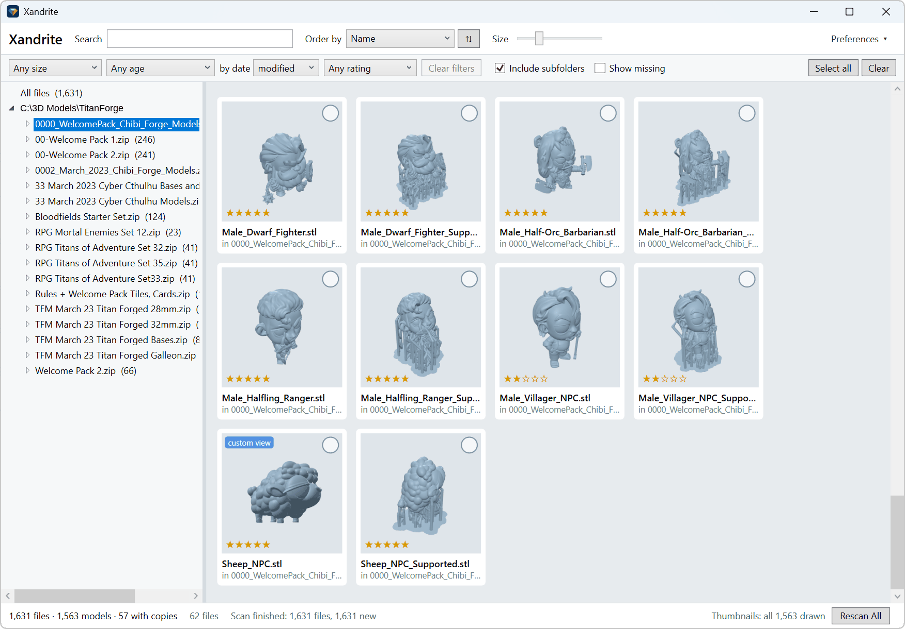

# Xandrite

*Every model has a side worth seeing.*

Xandrite WAS a Windows 10/11 and Linux desktop app - now its JUST a Windows 10/11 app. It's for organising a large collection of `.stl` and `.3mf` files. Every file is identified by its
SHA-256, so it can be found again after it is moved or renamed. Why drop Linux support? Let's be honest the only way to get a linux/windows desktop experience that works is through electron and against my better judgment I used it and it worked but was Janky. It still needs work making it prettier, but it's already useful.

**Get the Windows 10/11 installer [Xandrite ](https://github.com/amwales-888/model-library/releases/latest)**

Q. Why do I need this? 
A. You have thousands of models, squirelled away in directories you never look in, in multi-gigabyte .zip archives that are a pain to unpack and look through, but you know that somewhere in there is a hidden gem, you just lost it. Xandrite will help you find the gems and organise them.

Q. How do I run it? 
A. Get the installer, it's pretty simple.

Q. WHere's the user manual? 
A. Take look here **[Getting started guide](Xandrite.NET/docs/getting-started.md)** (with screenshots).

Q. I'm a developer, give me a description of all the cool stuff, how it works and show me how to build it locally. 
A. Take look here **[Developer README](Xandrite.NET/README.md)**.

Q. Hang on did you say you can change the orientation of the model in the thumbnail and it will remember it? 
A. I didn't but YES you can.

# TLDR - Disclaimer and Descent into Madness
This application was completely written by AI. I was curious about how far the technology had progressed and, after talking to a number of people whose opinions I respect, I thought I would drop my prejudices and give it a try.

--------------------------

Below follows my personal descnt into madness, I lost track of time.

I setup an account with Claude, paid £18 for a monthly subscription and started with Claude Sonnet 5.5 paying attention to the Usage limits, I had heard horror stories.

I am more than suprised at the results.

I had an issue with organising 3d models, I have a lot, the collections grow especially if you have a login to myminifactory and join free promotions for their monthly tribes signups.

I have no prior experience writing UI applications in Javascript. And even now I cant tell you how any of this works which is concerning. I explained a simple idea to claude, thinking I would have to understand 3d graphics programming - 

"I am curious about 3d graphics rendered on a webpage. I would be interested in seeing how much effort is required to generate an application that could display a 3d model in a browser. My ultimate goal would be to create an application that other people could run without too much friction caused by OS or language selection. Can we start with a rotating cube?"

It generated a single html page with a rotation cube, not just a rotating cube but buttons and camera controls too!

Next I thought I have an idea of how the library I want will work, recursing through a directory, collecting files with .stl extensions and generating SHA hashes for thumbnail files so that associations wouldnt get lost when I was finally able to generate some kind of thumbnail - what happened.

"I am a developer but have never worked on GUI code.
I have an idea for an application that at its core is a database that contains thumbnails for 3d files. The database is browsable like a file explorer and the thumbnails are linked to the original files via a sha so that can be found if moved. The format of the files is .stl or .3mf I think starting with a simple case of 1 directory and a small number of files how would you proceed?"

What followed was more a conversation about possible directions and end with me asking it to try one of the options it had offered.

This is where things got scary, it generated a single page application that allowed me to view a 3d model that I could drop onto a canvas from explorer and manipulate the view. It had made a button for saving the file as a .png

I kept going, back and forth, it made few if any mistakes. I was doing all this from a prompt, no ide, no tool integration. I started with a simple html file and then after I asked how it should progress, it said 'lets build an application' it gave me a number of choices and I chose electron, something I have a deep irrational hate of. It's enormouse, it's slow, it's javascript. But it works on Mac/Linux and Windows, people do some incredible things with it and I keep telling myself - hey it can be ported to a real language/framework later right?

Claude told me what I needed to install on my linux WSL environment, the verions of node, how to install it. This is getting out of hand.

It got to the point where Claude was delivering .tgz files to me containing the application source code. I would move the old application asside, untar the delivered files, cargo culting 'npm install ; npm test ; npm start' I really have very limited knowledge of how it works, what the thousands of packages its pulling are and what the messages it's sprouting are. All I know is that when its done, an application appears in front of me and it works? WTF is this? Deep down you know its wrong, its everything you hate but its a drug and every download gives you more of what you asked for - and it works!

Then i wanted to run it on windows. Claude said 'no problem' just run this command 'npx electron-builder --win portable' and there it was the .exe and I copied it to another windows machine and it worked. And Im scared, I'm not a programmer now, Im a prompter, hoping that it userstands what I tell it and so far everytime I ask it to do something it does it. I started to  anthropomorphize it and asks it if 'do you think you could?', 'can you please', 'hey if you are tired we can do this later' - We?

And that was that, back and forth until I got something I think works and kinda looks good, I have no idea how to maintain in the future but I am not sure I care.

Will I port it? I doubt it, it runs fast enough for me to use. I had it working its way through 9,000 files and I walked the dog. It didn't crash, it didn't reformat my machine. I can browse those files now that are nested inside that 6GB multipart 7zip file without having to unzip them all first.

How long did it take to descend into this madness? Oh I spent a few hours on Sunday night, a bit of Monday and I'm writing this Tuesday morning.

Oh today, Tuesday evening Claude built the actions to instruct GitHub how to generate the installers when a Tag is pushed, I am at a loss for words.

To show how bad it got, I started on Tuesday evening, NOT Sunday and today is Thursday, NOT Tuesday. I am retired and get weekdays muddled now.

Ok so installers done, what about branding, all things need a name. Model-Library isnt going to cut it. I want something that not confused by something else when you search for it. Claude gave me some ideas and not after that, I'm not sure, sounds a little harsh, like a detergant. I'll give it a few days and see...

It's Saturday, Claude was busy last night, I asked it to port everything to a .NET WPF application for Windows 10/11. I abandoned electron and the evil that is Javascript, node and npm. The cargo cult of downloading god knows what and the [600 node packages required for a HelloWorld app](https://news.ycombinator.com/item?id=47074571)
