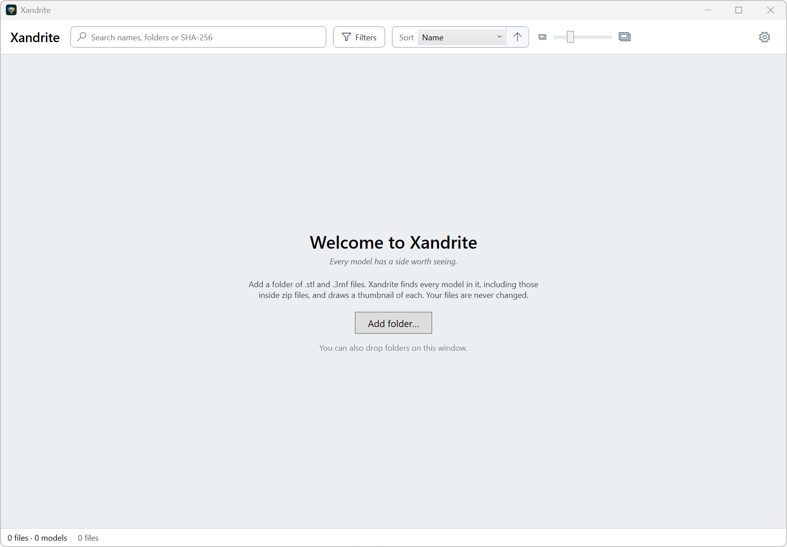
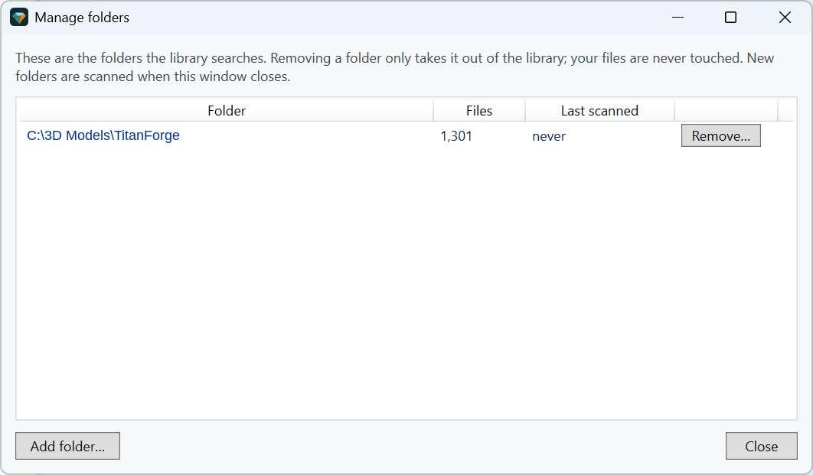
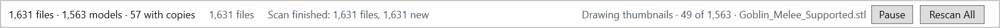
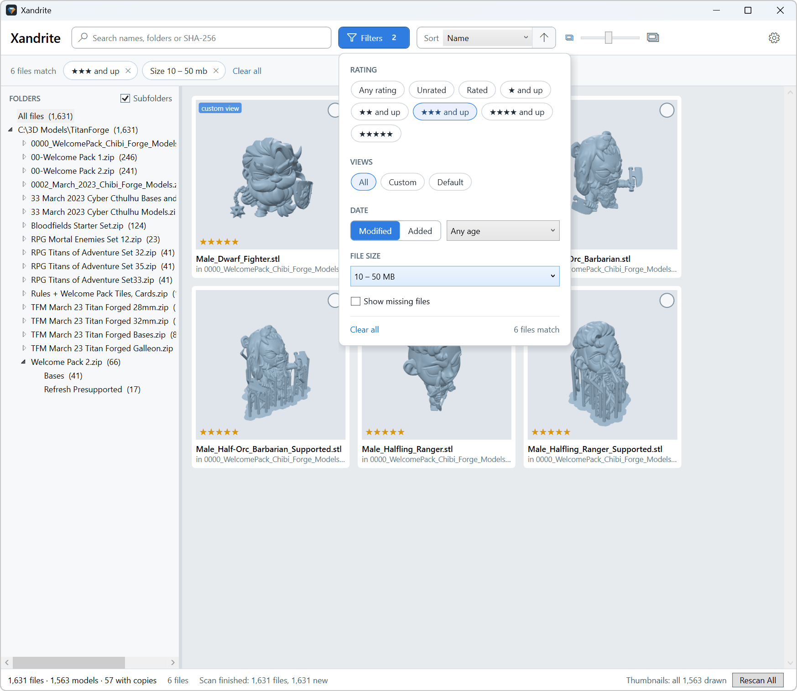
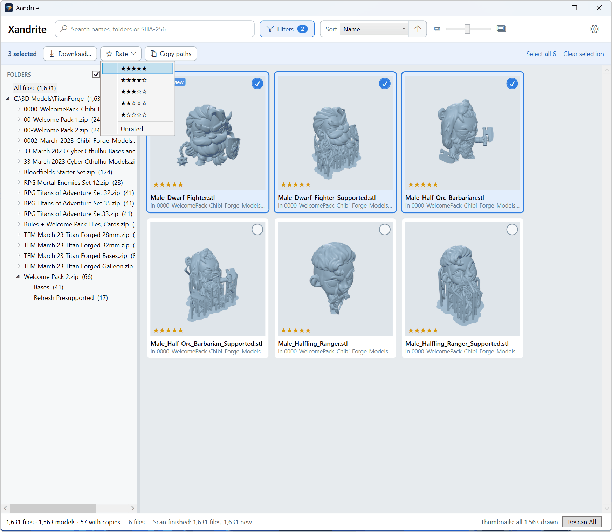
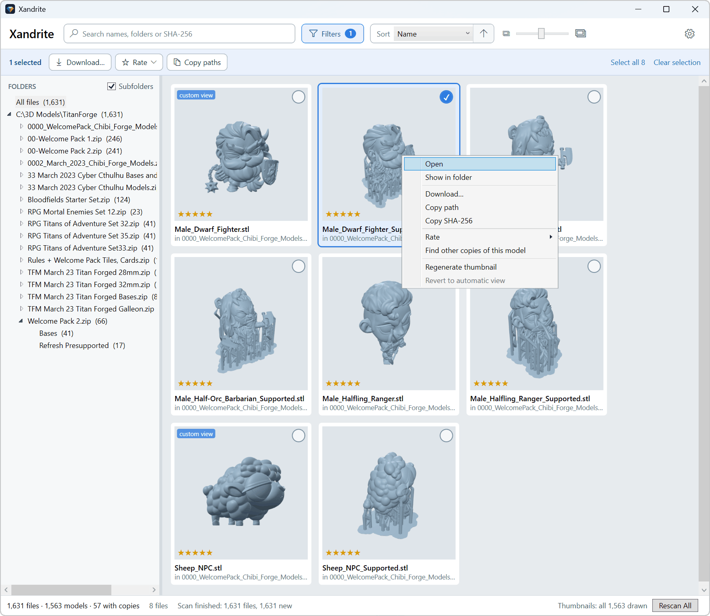
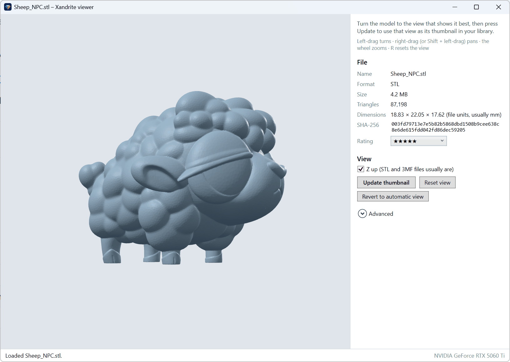
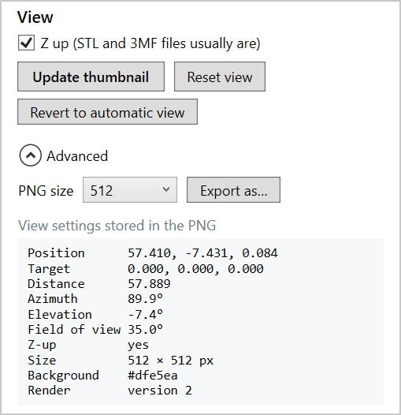
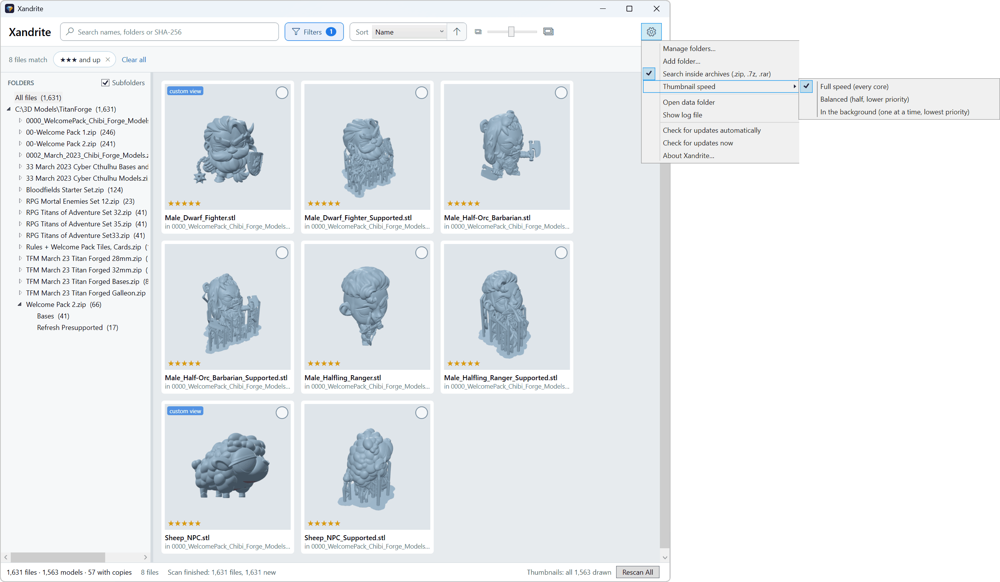
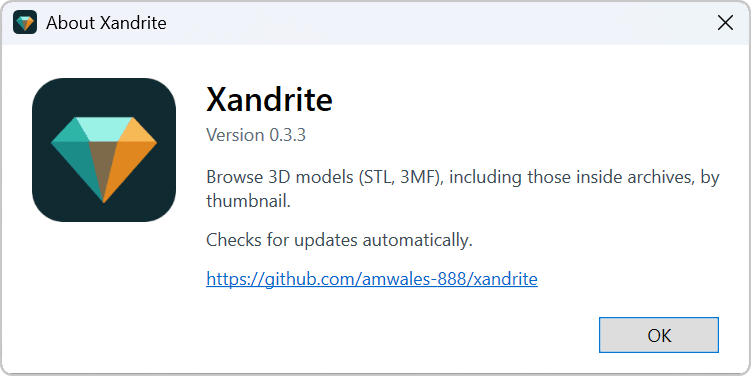

# Xandrite user manual

*Every model has a side worth seeing.*

Xandrite is a Windows app for browsing a collection of 3D models by thumbnail. Point it at the folders where you
keep your `.stl` and `.3mf` files. It finds every model, including models inside `.zip`, `.7z` and `.rar` archives,
and draws a thumbnail of each one. You can then search, sort, filter, rate and open your models in a 3D viewer.

Your files are never changed. Xandrite only reads them, and keeps what it learns in a library of its own.

## Contents

1. [Installing Xandrite](#1-installing-xandrite)
2. [The first start](#2-the-first-start)
3. [Adding your folders](#3-adding-your-folders)
4. [Scanning: how Xandrite finds models](#4-scanning-how-xandrite-finds-models)
5. [Thumbnails](#5-thumbnails)
6. [Browsing the library](#6-browsing-the-library)
7. [Selecting and rating models](#7-selecting-and-rating-models)
8. [Right-click actions](#8-right-click-actions)
9. [The viewer](#9-the-viewer)
10. [Preferences](#10-preferences)
11. [Updates](#11-updates)
12. [Where Xandrite keeps its data](#12-where-xandrite-keeps-its-data)
13. [Troubleshooting](#13-troubleshooting)
14. [Keyboard shortcuts](#14-keyboard-shortcuts)

---

## 1. Installing Xandrite

1. Go to the [Releases page](https://github.com/amwales-888/xandrite/releases) and open the newest
   **Xandrite.NET** release.
2. Download **`Xandrite.NET-win-Setup.exe`** and run it.
3. When Setup finishes, Xandrite asks whether to start now. Choose **Yes** to open it straight away.

Setup installs Xandrite for your Windows account only, so it doesn't ask for administrator rights. It adds
**Xandrite** shortcuts to the Start menu and the desktop.

> **If Windows blocks the installer.** Xandrite isn't code-signed yet, so Windows may stop it:
> - **"Windows protected your PC"** (SmartScreen): click **More info**, then **Run anyway**.
> - **"Smart App Control blocked an app"**: there's no "Run anyway" for this one. Smart App Control can only be
>   turned off as a whole, under *Windows Security → App & browser control → Smart App Control settings*. It has to
>   stay off while you use Xandrite, because it checks every start, not just the install.

**Uninstalling:** open *Settings → Apps → Installed apps*, find **Xandrite** and choose **Uninstall**. Your library
(ratings, saved views, thumbnails) is kept, in case you install it again. Section 12 says where it is, if you want to
delete it too.

**System requirements:** Windows 10 or 11, 64-bit. Any graphics card from the last decade or so will do. Without a
suitable one, Xandrite falls back to drawing with the processor, which works but is slower.

---

## 2. The first start

When your library is empty, Xandrite shows the welcome screen:

Click **Add folder…** and choose a folder of models to get going. You can also drag a folder from File Explorer onto
the window.

> **Coming from the earlier Xandrite (the Electron app)?** On its first start, this Xandrite copies your old
> library across automatically: folders, ratings, saved views and thumbnails. The database comes first, then the
> thumbnail images in the background (the status bar shows progress). Your old library is only read, never changed,
> so both apps can stay installed side by side.

---

## 3. Adding your folders

Xandrite's library is made of the folders you add. Every model inside them, in subfolders at any depth and
inside archives, becomes part of the library.

You can add folders in three ways:

- **Add folder…** on the welcome screen, or under **Preferences (the gear) → Add folder…**
- **Drag folders** from File Explorer onto the library window.
- **Preferences (the gear) → Manage folders…** opens a window listing every folder, with how many files it holds and when it
  was last scanned. Add as many as you like there; they're all scanned when you close the window.

### Removing a folder

In **Manage folders**, click **Remove…** next to the folder. Or right-click the folder in the folder tree and choose
**Remove from library…**. Xandrite asks what to do with the information it holds about that folder's models:

- **Yes:** remove the folder, and also delete its models' thumbnails, saved views and ratings, unless the same model
  is also in another folder.
- **No:** remove the folder but keep that information, so adding the folder again brings everything back.
- **Cancel:** keep the folder.

Either way, **your files are never touched**: removing a folder only takes it out of the library.

---

## 4. Scanning: how Xandrite finds models

When you add a folder, Xandrite **scans** it. It looks at every file and recognises the models: `.stl`
(binary or text) and `.3mf`. It also looks inside archives (`.zip`, `.7z` and `.rar`, including split and
multi-part archives) and reads the models they contain without unpacking them to disk.

Each model is identified by its **contents**, not its name, using a SHA-256 fingerprint. This means:

- If you **rename or move** a model within your folders, Xandrite recognises it at the next scan and keeps its
  rating, saved view and thumbnail.
- If the **same model** is in several places, for example a loose copy and another inside a zip, Xandrite knows
  they're the same model. See *Find other copies of this model* in section 8.

### Rescanning

Xandrite doesn't watch your folders all the time. After you've added, moved or deleted models, rescan:

- **Rescan All** in the bottom-right corner, or press **F5**, to rescan every folder.
- Right-click a folder in the folder tree and choose **Rescan this folder** to rescan just that one.

Rescanning is quick: files that haven't changed since the last scan are skipped, and an archive is only opened again
if it has changed. A scan in progress can be stopped with **Cancel** in the status bar.

### Missing models

If a model was in the library but isn't found at a scan (deleted, or moved out of your folders), it is marked
**missing**. Missing models are hidden unless you turn on **Show missing files** under **Filters**; they then appear with a red *missing* badge.
If the file comes back, the next scan finds it again, with its rating and view intact.

---

## 5. Thumbnails

After a scan, Xandrite draws a thumbnail for every model that doesn't have one yet. It works in the background, so
you can carry on browsing. The status bar shows how far it has got, along with the library totals ("57 with copies"
counts models found in more than one place) and the last scan:

- **Pause** and **Resume** stop and restart the drawing.
- If a model can't be drawn (a damaged file, say), its tile says *Could not draw*. Hover over the tile to see why.
  **Retry failed** in the status bar tries all of them again.
- Models waiting their turn show *Waiting for thumbnail*.

Each thumbnail is drawn from a standard angle that suits most models. When a model deserves a better view, open it in
the viewer, turn it to the view you like, and click **Update thumbnail** (see section 9). Tiles drawn from a view you
chose carry a blue *custom view* badge.

### Thumbnail speed

With a large collection, drawing every thumbnail takes a while and can keep your processor busy. Choose how hard
Xandrite works under **Preferences (the gear) → Thumbnail speed**:

| Setting | What it does | When to use it |
|---|---|---|
| **Full speed** | Draws several models at once, using every core. | The default. Fastest, when you're not using the computer for much else. |
| **Balanced** | Half as many at once, at lower priority. | Working alongside other programs. |
| **In the background** | One model at a time, at the lowest priority. | Leaves the computer free for other work. |

You can change the setting at any time, even while thumbnails are being drawn. It takes effect from the next model, and
Xandrite remembers it. The status bar shows *(balanced)* or *(in the background)* when the queue isn't at full speed.

---

## 6. Browsing the library

### The folder tree

On the left is a tree of your folders, with **All files** at the top. Click a folder to show only its models.
The **Subfolders** tick above the tree decides whether models in its subfolders are shown too.

### Search

Type in the search box at the top (or press **Ctrl+F** to jump to it). Search matches any part of a file name or folder,
for example `gear`, `chess` or `Mechanical\Spares`. Pasting a model's SHA-256 finds that exact model.

### Sort

**Sort** orders the grid by **Name**, **Folder and name**, **Date modified**, **Date added** (to the library),
**File size** or **Rating**. The arrow beside it shows which way the list runs and reverses it; hover over it to see
which way ("A to Z", "Newest first"...). When sorting by date, each tile shows its date underneath.

### Filters

Click **Filters** in the toolbar to narrow the grid further:

- **Rating:** any, unrated, rated, at least one to four stars, or five stars.
- **Views:** **All**; **Custom**, models whose thumbnail is drawn from a view you saved in the viewer (the tiles with
  the *custom view* badge); or **Default**, models still using the automatic view. Handy for finding the models you
  haven't given a better angle yet.
- **Date:** choose **Modified** or **Added**, then a period: the last 24 hours, 7 days, 30 days or year, or more than a
  year ago.
- **File size:** under 100 KB, 100 KB – 1 MB, 1 – 10 MB, 10 – 50 MB, over 50 MB.
- **Show missing files:** includes models that weren't found at the last scan.

While any filters are on, the Filters button turns blue and shows how many, and they appear as **chips** under the
toolbar ("★★★ and up", "Modified in the last 30 days"), with how many files match. Click a chip to turn that filter
off, or **Clear all** to turn them all off. With no filters on, the chips go away and the grid gets the space.

### Tile size

The slider in the toolbar, between a small and a large picture, makes the thumbnails bigger or smaller.

### Tiles

Each tile shows the thumbnail, the model's name and its rating. Hover over a tile for its full path, size and format,
the archive it's in, and why its thumbnail failed, if it did.

---

## 7. Selecting and rating models

### Selecting

| To… | Do this |
|---|---|
| Select one model | Click it (click again to deselect) |
| Add or remove one model | **Ctrl**-click it, or click the round tick in its top-right corner |
| Select a range | **Shift**-click |
| Select everything shown | **Ctrl+A**, or **Select all** in the selection bar |
| Clear the selection | **Esc**, or **Clear selection** in the selection bar |
| Move the selection | The arrow keys |

While models are selected, a blue **selection bar** appears under the toolbar. It shows how many are selected and
offers **Download…**, **Rate** and **Copy paths** for all of them, plus **Select all** and **Clear selection**.

### Rating

Give models one to five stars, to find your favourites later (sort or filter by **Rating**):

- Select one or more models and press **1** to **5**. Press **0** to clear the rating.
- Or right-click and choose **Rate**.
- Or set the rating in the viewer.

---

## 8. Right-click actions

Right-click a tile, or a selection of tiles, for these actions:

- **Open:** opens the model in the viewer. Double-clicking or pressing **Enter** does the same.
- **Show in folder:** opens File Explorer with the file selected. For a model inside an archive, it selects the archive.
- **Download…:** copies the selected models into a folder you choose. Models inside archives are extracted as
  ordinary files. Existing files are never overwritten: a second `gear.stl` is saved as `gear (2).stl`.
- **Copy path** / **Copy SHA-256:** copies to the clipboard, one line per model.
- **Rate:** sets the rating of every selected model.
- **Find other copies of this model:** shows every place the same model is found, whatever its name. Handy for
  tidying up duplicates.
- **Regenerate thumbnail:** draws the thumbnail again.
- **Revert to automatic view:** forgets a view saved in the viewer, and redraws the thumbnail from the standard
  angle.

Right-clicking a **folder** in the folder tree offers **Rescan this folder**, **Show in Explorer** and
**Remove from library…**.

---

## 9. The viewer

Double-click a model (or select it and press **Enter**) to open it in the viewer:

### Moving around

| To… | Do this |
|---|---|
| Turn the model | Drag with the **left** mouse button |
| Move (pan) | Drag with the **right** mouse button, or **Shift** + left-drag |
| Zoom | The mouse **wheel** |
| Go back to the start | Press **R**, or click **Reset view** |

The view never rolls or flips over the top, so the model always stays the right way up.

### The side panel

- **File:** the model's name, format, file size, number of triangles, dimensions, SHA-256 and **Rating**. You can change
  the rating here.
- **Z up:** STL and 3MF files usually treat Z as "up", so this is on by default. If a model appears lying on its
  side, try turning it off.
- **Update thumbnail:** makes what you see now the model's thumbnail in the library, and remembers the view. The
  library grid updates straight away and marks the tile *custom view*. If the thumbnail is ever redrawn, this view
  is used.
- **Revert to automatic view:** forgets your view and goes back to the standard angle.

### Exporting a picture

Open **Advanced**, choose a **PNG size** (256 to 2048 pixels) and click **Export as…** to save the current view as a
PNG image. The file is named after the model by default (`twisted-vase.png`, for example).

Advanced also shows the view settings stored inside the image. Xandrite uses them to redraw a thumbnail exactly as
you left it.

> You can also drag an `.stl` or `.3mf` file from File Explorer onto the viewer to look at it, even one that isn't in
> your library. A file from outside the library can be looked at and exported, but not rated or given a thumbnail. If the
> same model is already in your library, **Update thumbnail** works for it.

---

## 10. Preferences

The **Preferences** menu, under the gear at the top right of the library window:

| Item | What it does |
|---|---|
| **Manage folders…** | Lists your library folders; add and remove them (section 3). |
| **Add folder…** | Adds one folder. |
| **Search inside archives** | Whether scans look inside `.zip`, `.7z` and `.rar` files. On by default. |
| **Thumbnail speed** | Full speed, Balanced or In the background (section 5). |
| **Open data folder** | Opens the folder where Xandrite keeps its library (section 12). |
| **Show log file** | Opens Xandrite's log in your text editor (section 13). |
| **Check for updates automatically** | On by default (section 11). |
| **Check for updates now** | Checks straight away. |
| **About Xandrite…** | Shows the version and update status. |

---

## 11. Updates

Xandrite keeps itself up to date. About ten seconds after it starts, it checks for a new version. If there is one,
it downloads it in the background and the status bar shows **Restart to update**:

- Click **Restart to update** to install it now. Xandrite closes, updates and starts again in a few seconds.
- Or carry on. The update is installed the next time you start Xandrite.

Only the parts that changed are downloaded, so updates are usually small. To stop the automatic checks, untick
**Preferences (the gear) → Check for updates automatically**. **Check for updates now** still works when you want it.

---

## 12. Where Xandrite keeps its data

| What | Where |
|---|---|
| The library: folders, models, ratings, views | `%APPDATA%\Xandrite.NET\library.sqlite` |
| Thumbnails | `%APPDATA%\Xandrite.NET\thumbnails` |
| The log file | `%APPDATA%\Xandrite.NET\logs\xandrite.log` |
| The app itself | `%LOCALAPPDATA%\Xandrite.NET` |

**Preferences (the gear) → Open data folder** takes you to the first. Thumbnails can always be redrawn, but **ratings and
saved views live only in `library.sqlite`**, so include that folder in your backups.

---

## 13. Troubleshooting

**A thumbnail says "Could not draw".** Hover over the tile to see why. Usually the file is damaged, isn't really a
model, or is protected with a password (inside an archive). Fix or replace the file, rescan, and click
**Retry failed**.

**A model I added doesn't appear.** Rescan its folder (right-click it in the folder tree). Check that
**Search inside archives** is on if the model is inside an archive, and that no filter or search is hiding it
(**Clear all**, beside the filter chips).

**Thumbnail drawing makes my computer sluggish.** Set **Preferences (the gear) → Thumbnail speed** to **In the background**.

**"Thumbnails stopped" in the status bar.** The graphics driver had a problem, for example after the computer
woke from sleep or the driver was updated. Click **Resume**.

**The log file.** Xandrite writes what it does to a log: every scan, every thumbnail, every problem, with times and
reasons. **Preferences (the gear) → Show log file** opens it. If you report a problem, the log is the most useful thing to
include. It's kept to a sensible size automatically.

---

## 14. Keyboard shortcuts

### Library

| Key | Action |
|---|---|
| **Ctrl+F** | Go to the search box |
| **F5** | Rescan all folders |
| **Arrow keys** | Move the selection |
| **Enter** | Open the selected model in the viewer |
| **1** – **5** | Rate the selection |
| **0** | Clear the rating |
| **Ctrl+A** | Select everything shown |
| **Esc** | Clear the selection |

### Viewer

| Key or mouse | Action |
|---|---|
| Left-drag | Turn |
| Right-drag, or Shift + left-drag | Pan |
| Wheel | Zoom |
| **R** | Reset the view |
