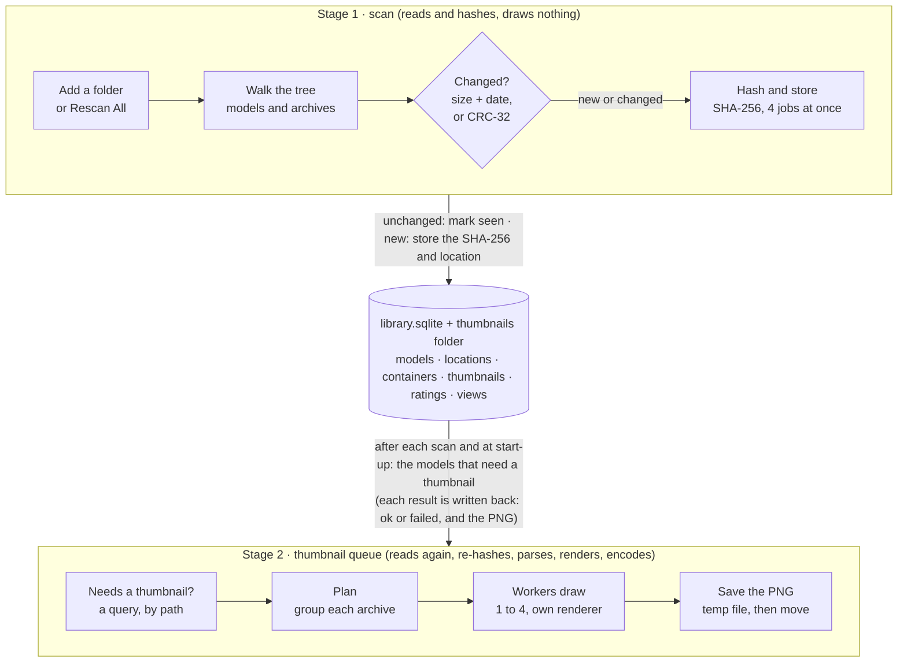

# How Xandrite.NET works: from adding a folder to finished thumbnails

This describes the flow in enough detail to build the same system without the user interface: what the scan does,
what the thumbnail queue does, how archives and the SHA-256 are used, and how the threads and async tasks are kept
out of each other's way.

## Overview

Adding a folder runs two separate stages that meet only in the library database. The scan records what files exist
and what each contains (its SHA-256); the thumbnail queue then draws one image per distinct content that has none.
Neither calls the other: the scan writes rows, and the queue reads them.

The scan only reads what changed since the last scan; the queue only draws what the database says is missing or out
of date. Either can stop at any point and pick up later from the database.

## The database and the SHA-256

A model is identified by the SHA-256 of its bytes, not by its path. Everything that belongs to the model itself (the
thumbnail, the rating, the saved camera view) hangs off that hash. Everything about where it was found (the path,
size, date, which archive) hangs off the path. Two copies of a file are one model with two locations, and a renamed or
moved file keeps its thumbnail and rating because its hash is unchanged.

The library is one SQLite file (`library.sqlite`) opened in WAL mode with `synchronous = NORMAL` and foreign keys on.
Thumbnails are PNG files named `<sha256>.png` in a `thumbnails` folder beside it.

| Table | Key | What a row says |
| --- | --- | --- |
| `roots` | `path` | A folder the user added; `added_at`, `last_scanned_at` (set only by a complete, uncancelled scan). |
| `models` | `sha256` | One distinct content: `size`, `format` (stl, 3mf or obj), `first_seen_at`. Inserted with `INSERT OR IGNORE`, so a second copy changes nothing. |
| `locations` | `path` | One place a model was found: `root`, `sha256`, `size`, `mtime_ms`, `last_seen_scan`, `added_scan`, `missing` (0/1). For a model inside an archive also `container` (the archive's path), `entry` (the name inside it, forward slashes) and `crc32` (the archive's checksum for that entry). |
| `containers` | `path` | An archive read completely without problems: `root`, `size`, `mtime_ms`, `last_seen_scan`, `formats` (the kinds of model it was looked through for, `.3mf,.obj,.stl`). Its presence means "unchanged since then, no need to open it", as long as `formats` matches the kinds read now. |
| `thumbnails` | `sha256` | `status` (ok or failed), `render_version`, `size_px`, `error`, `created_at`. No row means "never drawn". |
| `ratings` | `sha256` | 0 to 5 stars. No row means unrated. |
| `views` | `sha256` | A saved camera (position, target, field of view, Z-up) used instead of the automatic one. |
| `settings` | `key` | Preferences as text. |

Indexes: `locations(sha256)`, `locations(root)`, `locations(container)` and `locations(sha256, missing)`.

### The path of a model inside an archive

It is stored under a virtual path: the archive's own path followed by the entry's folders, for example
`C:\Models\kit.zip\figures\knight.stl`. The folder tree and search treat it like any other path. `container` and
`entry` say how to get the bytes back.

### Found in the database, or not

For a loose file the scan compares the stored `size` and `mtime_ms` for that path with the file system's.

- **Same size and date:** the file is not read. Its row gets `last_seen_scan = <this scan>` and `missing = 0`. This is
  what makes a rescan of 60,000 unchanged files take seconds.
- **Different, or no row:** the file is read and hashed. The `models` row is inserted if the hash is new. The
  `locations` row is inserted or updated (an upsert on `path`) with the new hash, size and date. A new row also gets
  `added_scan = <this scan>`.
- **A row that this scan did not see:** after a complete scan, it is marked `missing = 1`, never deleted. Its rating,
  view and thumbnail stay with the hash.
- **Moved:** a location added this scan whose hash also belongs to a location now missing. Nothing special is stored;
  it is counted at the end of the scan, and the thumbnail is already there because it belongs to the hash.

For an entry inside an archive the comparison is `size` plus `crc32` for its virtual path (CRC-32 rather than the
entry's date, because zip readers disagree on dates). A whole archive whose file `size` and `mtime_ms` match its
`containers` row is not opened at all: every location with that `container` is marked seen in one statement.

When a new kind of model is supported (`.obj` was added after `.stl` and `.3mf`), archives recorded with the older
set of kinds are opened once more on the next scan. Their known models are not read again: zip entries are only
decompressed when opened, and 7-Zip is told which entries the library already has unchanged and leaves them out of
the extraction, so an archive with nothing new in it is only listed.

### What decides that a model needs a thumbnail

A model needs one when it is present somewhere (`EXISTS` a location with `missing = 0`) and either has no
`thumbnails` row, or has an `ok` row with a `render_version` older than the current one (2). Failed rows are not
retried until the user asks. Raising the render version therefore redraws everything, while the old image is shown
until its replacement is ready.

### Scan ids

Each scan has an id: its start time in milliseconds, but always at least one more than the largest `last_seen_scan`
stored, so two scans can never share an id. `last_seen_scan` and `added_scan` make "new this scan" and "not seen this
scan" simple comparisons.

## Stage 1: the scan

The scan makes the database describe what is on disk, as cheaply as possible: it reads only files it has not seen in
their current state, and it draws nothing. Adding a folder inserts a `roots` row and scans it; Rescan All scans every
root, one after another.

1. **Open the scan.** Check the folder exists. Choose the scan id. Read the root's previous `last_scanned_at` for the
   statistics. Start a progress timer (every 30 seconds) for the log.
2. **Walk the tree.** A single loop enumerates the folder depth first and yields one item per model file (`.stl`,
   `.3mf`, `.obj`), per archive (`.zip`, `.7z`, `.rar`, and the first part of a split set), or per problem (a folder or file
   that could not be read). It skips names starting with `.` and `__MACOSX`, and does not follow symbolic links or
   junctions, so a link back up the tree cannot loop. Later parts of a split set (`.7z.002`, `.part2.rar`, `.r00`) are
   not yielded; the first part carries the set, and a set with a part missing is yielded as incomplete.
3. **For each loose model file:** count it as found, look up its path, then either mark it seen (unchanged) or start
   a hash job (changed or new). See the previous section for the rules.
4. **For each archive:**
   - incomplete split set, or no reader for its type: keep what is known (mark its locations seen) and record a
     problem;
   - `containers` row matches its size and date: mark all its locations seen and count them as found and unchanged,
     without opening it;
   - otherwise start an archive job (next section).
5. **Hash job (loose file).** Read the file in 1 MB pieces through SHA-256, then in one locked database call insert
   the `models` row (if new) and upsert the `locations` row. A file that cannot be read (locked, permission denied) is
   marked seen rather than missing, and recorded as a problem.
6. **Limit the jobs in flight.** At most 4 hash or archive jobs run at once. When 4 are running, the walk waits for
   any one to finish before it goes on. An archive counts as one job however many models it holds.
7. **Wait for the last jobs**, then stop the progress timer.
8. **Finish, in one locked database call:**
   - only if the scan was not cancelled and no folder failed to list: mark `missing = 1` on this root's locations whose
     `last_seen_scan` is not this scan, and delete `containers` rows not seen (archives that are gone);
   - only if not cancelled: set the root's `last_scanned_at`;
   - count new locations (`added_scan` = this scan), moved models, and groups of copies;
   - write the `scan.end` and `scan.metrics` log lines and the statistics line.
9. **Hand over.** The caller re-reads the folder tree and list, and starts the thumbnail queue.

The rule in step 8 is the scan's main safety net: a scan that stops part way, or that cannot see part of the tree (a
network share dropping a folder), must never make files look deleted. Those files simply keep their old rows until a
clean scan.

While a scan runs, the folder tree and the file list are re-read every 2 seconds on a worker thread, so new folders
and "Waiting for thumbnail" tiles appear as they are found. Each archive entry and each file is committed as soon as
it is hashed, which is what makes that possible.

## Archives and the files inside them

Archives are never unpacked to disk. Each model inside one is decompressed into memory, hashed from its decompressed
bytes, and stored under its virtual path, so a model has the same SHA-256 whether it is loose or zipped.

### Readers

| Kind | Reader | How entries are read |
| --- | --- | --- |
| `.zip` | .NET `System.IO.Compression` | The directory at the end is read, then each wanted entry is opened and inflated in the order stored. A zip can jump to any entry. |
| `.7z`, `.rar` (RAR 4 and 5, solid or not) | 7-Zip's own library (`7z.dll`) in the app's process, through its COM interfaces | All wanted entries in one `Extract` call, in archive order. For a solid archive (one compressed stream for many files) this decompresses the stream once instead of once per entry. 7-Zip checks each entry's CRC itself. |
| Split sets (`.7z.001`…, `.part1.rar`…, `.rar` + `.r00`…) | 7-Zip | The parts are presented to 7-Zip as one stream (7z sets) or through its volume callback (RAR). |

Every archive file is opened through one helper: an unbuffered file stream, wrapped by a meter (bytes, time, slow
reads) and optional developer logging, then a read buffer (1 MB by default). Decompressors ask for small pieces (zip
8 KB, 7-Zip up to 256 KB), and those are served from the buffer, so the disk or share sees a few large sequential
reads.

### What is read, and what is skipped

Each entry name is classified before anything is decompressed:

- folders, names with a segment starting with `.`, and `__MACOSX` → skipped quietly;
- `..` or `.` segments → skipped and reported as unsafe;
- an archive inside the archive (nested) → not opened, only counted;
- anything that is not `.stl`, `.3mf` or `.obj` → skipped;
- password-protected → reported, not read;
- larger than 2 GB uncompressed → reported, not read;
- over 200 MB and compressed more than 1000 : 1 → reported as a likely zip bomb; for 7-Zip the whole archive is
  refused if its total is.

The archive's directory may hold at most 200,000 entries.

### Scanning an archive (one job)

1. For each eligible entry, in archive order, the reader hands over the entry's name, size, date, CRC-32 and a way to
   open its bytes.
2. If the entry's virtual path is known with the same size and CRC-32, it is marked seen and nothing is decompressed
   (7-Zip asks before extracting, and leaves known entries out; for a solid archive, what comes before a new entry
   in the same block is still decompressed to reach it).
3. Otherwise the bytes are hashed and stored like a loose file, with `container`, `entry` and `crc32` set.
4. An entry that fails is marked seen (its old row survives) and reported; the archive is then not "clean".
5. A clean archive gets a `containers` row with its size and date, so the next scan skips it unopened. A failed one
   only has its row touched, so it is looked at again next time.
6. An archive that cannot be opened at all keeps all its locations (marked seen) and is reported.

For 7-Zip, `Extract` runs on 7-Zip's own threads and calls back once per entry. The callback waits for the
hash-and-store of that entry before returning, so entries are handled one at a time, in order, and memory holds one
entry at a time.

### Reading models back for thumbnails

The thumbnail stage groups the models of one archive and reads them in a single pass: one open, front to back,
delivered one by one. Reading a zip once per model filled a whole read buffer each time and read 2.7 times the size of
the zips, so one pass matters. For a single model (the viewer, or an archive with one model waiting) the entry is read
on its own.

## Stage 2: the thumbnails

The thumbnail queue draws one 512 × 512 PNG per model (per SHA-256, not per file) for every model the database says
needs one. It is started at app start-up and after every scan, and it works from the database alone, so it can stop
at any point and carry on later.

1. **Start a run.** Only one run at a time. Calling Start during a run sets an "again" flag instead, so the run looks
   for new work before it ends (a scan finished meanwhile).
2. **Tidy up.** Any `ok` thumbnail row whose PNG file is gone is deleted, so the model counts as needing one again.
3. **Count** what is drawn, failed and waiting (once, then kept up to date in memory).
4. **Fetch the work:** every model needing a thumbnail, with one present location to read it from, ordered by path so
   a folder's models finish together. Models skipped earlier in this run are left out.
5. **Plan.** Models in the same archive (two or more waiting, each under 512 MB) become one archive item, placed where
   its first model would have been. Every other model is a single item. The items go into a shared work queue.
6. **Workers take items.** Each worker owns one renderer and loops:
   - first, help with models that an archive being read has already produced;
   - otherwise take the next item: a single model is read and drawn; an archive item starts a reader that streams its
     models out one at a time, and this worker draws them as they come;
   - when there is nothing new but an archive is still being read, wait for its next model;
   - when there is nothing at all, stop.
7. **Draw one model:**
   - read its bytes (whole file into memory; models over 512 MB fail with a reason);
   - hash the bytes and compare with the SHA-256 the scan recorded; if they differ, the file changed since the scan, so
     skip it (the next scan will record the new content);
   - look up a saved view for that SHA-256;
   - parse the STL, 3MF or OBJ into a mesh, render it off-screen with Direct3D 11, encode a PNG;
   - under a per-SHA lock, check the saved view did not change while drawing (the viewer may have saved one: its image
     wins);
   - write the PNG to a unique temporary name, then move it over `<sha256>.png` (retrying briefly if the file is in
     use);
   - record an `ok` row with the current render version; tell the UI that this SHA has a new image.
8. **Failures.**
   - The file is gone, or a model is gone from its archive → skipped for this run, no row written; the next scan will
     mark it missing.
   - The file cannot be read or parsed, or is too large → a `failed` row with the reason, shown on the tile, not
     retried until "Retry failed".
   - The renderer itself fails (a graphics driver reset, the device lost) → not the model's fault: that worker's
     renderer is thrown away, the queue goes into a "stopped" state, and nothing more is drawn until the user clicks
     Resume, which makes new renderers.
9. **Loop** back to step 4 until nothing is fetched and no "again" was asked for. Then write the run's totals to the
   log and statistics, and raise Idle.

### The order models are drawn in

Across the library, models are drawn in path order (case ignored), so a folder's models finish together. Inside one
archive with several models waiting, they are drawn in the order they are **stored in the archive**, not
alphabetically:

- the archive is reached when the path order reaches its alphabetically first waiting model;
- a zip is read in the order of its own directory (normally the order the files were added); a 7z or RAR in 7-Zip's
  item order, which for a solid archive is the only sensible one, since reaching item 50 means decompressing items 1
  to 49 anyway;
- the reader keeps at most 2 models ahead, and the worker that took the archive draws them while idle workers help, so
  with 4 workers models 1 to 4 can be drawn at once and a small one can finish before a large one that came earlier;
- identical files are drawn once: a model's job uses its alphabetically first present location.

So a zip stored as `z.stl, a.stl, m.stl` is drawn z, a, m.

### Which way up

The automatic view stands STL and 3MF models with Z up, and OBJ models with Y up, the convention of the programs
that write OBJ files (Blender, ZBrush, Maya). A saved view records its own choice.

### Speed

Three settings limit how hard the queue works; a change applies from the next model.

| Setting | Workers drawing | Thread priority during CPU work | 7-Zip threads per archive |
| --- | --- | --- | --- |
| Full speed | all (CPU cores ÷ 4, between 1 and 4) | Normal | all |
| Balanced | half | Below normal | cores ÷ 4 |
| In the background | 1 | Lowest | 1 |

Workers above the current limit finish the model in hand, then idle until the limit rises or the work runs out.

### Pause and resume

Pause closes a gate that every worker checks before taking its next model; Resume opens it. Models being drawn finish.
The time paused is kept apart from the time working in the statistics.

## Why thumbnails are not drawn during the scan

The two stages are kept apart so that the scan stays quick and safe, and the drawing can be stopped, slowed and
resumed on its own. The design came from the Electron app and was kept. The price is that every archive with new
models is read twice.

- **The queue is driven by the database, not by the scan.** "Needs a thumbnail" is a query. Close the app half way
  through 50,000 thumbnails and the next start carries on where it stopped; a crash loses at most the models being
  drawn. Drawing inside the scan would tie the two together: a cancelled or crashed scan would leave models with no
  thumbnail and nothing to say they still need one.
- **The same queue serves other work.** A new render version (the look changed), "Retry failed", a view reverted in
  the viewer, a PNG deleted by hand: each simply makes models match the query, and the queue picks them up. No scan is
  needed.
- **The work is different.** Scanning is reading and hashing: disk or network bound, little CPU, and it streams, so a
  1 GB model never sits in memory. Drawing needs the whole model in memory, parsed into a mesh, then the GPU and a PNG
  encoder: CPU and GPU bound, and far slower per model. Hashing 4 at a time while drawing beside them would hold
  several whole models in memory per worker and slow the scan down to drawing speed.
- **The scan must be able to finish fast.** A rescan of an unchanged library takes seconds, and only a complete scan
  can say what is missing. Holding that up behind drawing would delay it by hours on a new library.
- **Duplicates and copies.** A thumbnail belongs to a SHA-256. The scan finds the first location of each model; the
  queue then draws each SHA once, from any present location, however many copies there are.
- **Independent controls.** Thumbnail speed, Pause and Resume, and recovery from a graphics driver reset apply to
  drawing only. A GPU problem never stops a scan.

**The cost**, seen in the statistics for 20 zips (about 20 GB): the scan reads 20 GB to hash, and the thumbnail run
reads the same 20 GB again to draw. On a slow network share this doubles the time spent reading. An option for the
future is to hand the decompressed bytes of new models straight to the queue while the scan has them in memory, when
the queue has a free worker, and fall back to the database-driven run for everything else.

## Threads, async tasks, and how problems are avoided

Almost all the work runs as async tasks on the .NET thread pool; only the UI and 7-Zip have threads of their own. An
async task is not a thread: it runs on a pool thread until it waits (for a read, a delay, another task), gives the
thread back, and continues later on whichever pool thread is free. So "4 hash jobs at once" means 4 tasks in progress,
not 4 dedicated threads.

### Who runs where

| Work | Runs on | How many at once |
| --- | --- | --- |
| Window, input, drawing the grid | The UI thread (one) | 1 |
| The scan's walk and its database look-ups | One task on the pool | 1 per scan; scans of several roots run one after another |
| Hashing a file, reading an archive during a scan | Pool tasks started by the walk | 4 |
| 7-Zip decompression | 7-Zip's own threads, inside one blocking `Extract` call made from a pool task | 1 call per archive job; 7-Zip's threads limited by the speed setting |
| The thumbnail run | One task on the pool | 1 |
| Thumbnail workers (read, hash, parse, render, encode, save) | Pool tasks, one per renderer | CPU cores ÷ 4, between 1 and 4 |
| Reading an archive's models for thumbnails | One producer task per archive being read | One per archive item in progress |
| Decoding tile images for the grid | Pool tasks, limited by a semaphore | A few |
| Progress timers, tree and list refresh during a scan, recounts | Short pool tasks | 1 of each at a time |

### Problems, and what prevents each

- **The database is one SQLite connection, which is not safe to use from two threads at once.** Every database call
  goes through one lock. Calls must therefore be short: a call that takes 0.1 s blocks every other thread, the UI
  included, for 0.1 s. The thumbnail status used to count the whole library (about 0.1 s on 60,000 files) after every
  thumbnail, which kept the lock busy all the time and froze the window. The queue now keeps the counts in memory,
  adjusts them per thumbnail, and recounts only occasionally on a worker thread.
- **The UI thread must never wait.** Background work never touches UI objects. It raises events, and the UI layer
  posts a small action to the UI thread at Background priority, so clicks, keys and repainting go first. Status text
  is updated at most every 200 ms however often progress arrives. Lists and trees are read from the database on a
  worker thread and only applied on the UI thread.
- **A late result overwriting a newer one.** The folder tree and the file list each have a version number that goes up
  on every full reload. A refresh read during a scan records the version it started from and is dropped if the number
  has moved (the user changed folder, search or filter, or the scan finished). Only one refresh of each runs at a time
  (an interlocked flag).
- **Counters touched by many tasks.** Shared counts are changed under a small lock (the scan's counts object, the
  queue's gate) or with `Interlocked` operations. Nothing slow happens while one of those locks is held.
- **Too much work at once.** The scan never has more than 4 jobs in flight; the walk waits when 4 are running. The
  queue's workers are a fixed number. An archive producer writes into a channel that holds at most 2 models, so it
  waits when the drawing falls behind and memory never holds more than a couple of models per archive.
- **A worker leaving while there is still work.** Taking an item from the work queue and counting "archives being
  read" happen together under the queue's lock, so no worker can see "no items and no archives" in the moment between
  another worker taking an archive and starting to read it.
- **Settings that must follow the work.** The speed limits and the I/O meter travel with the work in `AsyncLocal`
  values, which flow across awaits and into the tasks started from them, so the 7-Zip reader far below the queue knows
  its thread limit without being passed it.
- **Priority on shared threads.** Pool threads are shared, so a lowered priority must not leak. CPU-heavy steps run in
  a helper that sets the thread's priority for that step and puts it back afterwards.
- **7-Zip calling back on its own thread.** Its per-entry callback blocks on the async hash-and-store of that entry
  before returning. That is safe because 7-Zip's thread is not the UI thread, and it keeps entries in order with one
  in memory at a time.
- **Graphics state is not thread-safe.** Each worker owns its own Direct3D renderer; none is ever shared.
- **Two writers of one thumbnail** (the queue and the viewer saving a custom view). An async lock per SHA-256
  serialises them. Inside it, the queue checks that the saved view is still the one it drew with, otherwise the
  viewer's image stands. Files are written to a unique temporary name and moved over the real one, so a reader never
  sees half a PNG.
- **Cancellation.** Scans and runs take a cancellation token, checked between files and entries and passed to reads.
  A cancelled scan marks nothing missing. A stopped run leaves unfinished models waiting.
- **Closing the app.** It stops the queue, waits up to 5 seconds for the models in hand, then closes the database.
- **Reading a file that changed.** The thumbnail stage hashes the bytes it read and skips the model if they no longer
  match the scan's SHA-256, so a thumbnail is never filed under the wrong content.

## Building a duplicate without the UI

A headless version needs a library file, a scanner, an archive layer, a thumbnail queue and a renderer; the UI only
adds the views on top. Build them in this order, each testable on its own.

- [ ] **Library.** The tables in "The database and the SHA-256", WAL mode, one connection behind one lock. Keep every
  call short; keep running totals in memory instead of counting the whole library often.
- [ ] **Hashing.** SHA-256 over 1 MB reads, lowercase hex.
- [ ] **Walker.** Depth-first, skips hidden names and `__MACOSX`, does not follow links, yields models, archives
  (first part of split sets only) and problems instead of throwing.
- [ ] **Archive layer.** One interface: list-and-hand-over every model entry in archive order (for the scan), read
  many entries in one pass (for thumbnails), read one entry (for a viewer). Zip with any zip library; 7z and RAR with
  7-Zip. All files opened through one buffered, metered stream helper. Entry classification and the limits in
  "Archives and the files inside them".
- [ ] **Scanner.** The 9 steps of stage 1: scan id, unchanged check by size and date (loose) or size and CRC-32
  (entries) or size and date of the whole archive (containers), at most 4 jobs, commit each model as hashed, mark
  missing only after a clean, complete scan.
- [ ] **Thumbnail queue.** One run at a time with an "again" flag; fetch from the "needs a thumbnail" query ordered by
  path; group archives; N workers each owning a renderer; a bounded channel per archive being read; re-hash before
  drawing; temporary file then move; record ok or failed; speed limits, pause gate, blocked state for renderer
  failures.
- [ ] **Renderer.** Parse STL (text and binary), 3MF and OBJ into a mesh, frame it (or use the saved view), render
  512 × 512 off-screen, encode PNG. Give it a render version, stored with each thumbnail, so a change of look redraws
  everything.
- [ ] **Driver.** A command line that adds a folder, scans it, runs the queue until Idle, and prints the scan and run
  totals. The repository's `Xandrite.LibraryTool` already scans from the command line.
- [ ] **Logging and statistics.** One line per event, `key=value`, and one statistics line per scan and per thumbnail
  run, so runs can be compared.

Things a duplicate must not get wrong, in order of harm:

1. Marking files missing after a partial or cancelled scan.
2. Filing a thumbnail under the wrong SHA-256 (always re-hash what you draw).
3. Holding the database lock for long, or doing database work on the UI thread.
4. Reading an archive once per model instead of once per archive.
5. Unbounded memory: hash by streaming, draw from a bounded channel, cap model size.

Some details described here arrive with the pull requests open at the time of writing (#15 to #23): the archive read
buffer, the statistics file, reading each zip in one pass, refreshing the tree and list during a scan, and the
in-memory thumbnail counts.
